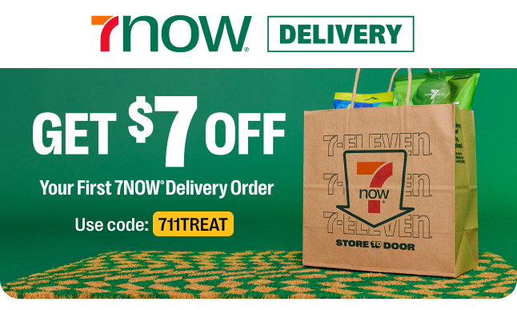

<p align="center">
  
</p>

# 7NOW Fulfillment Monolith


Demo back end for **7NOW**, 7-Eleven's convenience-store delivery service
([7-eleven.com/7now](https://www.7-eleven.com/7now/home)). Customers order cold drinks, snacks, pizza
and hot food from a nearby 7-Eleven store; store associates pick and pack the order; a driver delivers it.

It is a fork of the [FTGO monolith](https://github.com/microservices-patterns/ftgo-monolith) from
*Microservices Patterns*, rebranded to the 7NOW domain **without changing the architecture**: one Spring Boot
application (`sevenow-application`) on one MySQL schema (`sevenow`). It exists as the starting point for a
monolith-to-microservices refactoring exercise; see [docs/ARCHITECTURE.md](docs/ARCHITECTURE.md) for the module map,
table ownership per module and extraction notes.

## Domain

| Concept | Entity | Table | Notes |
|---|---|---|---|
| Store | `Store` | `stores`, `store_products` | `storeNumber`, `Address`, catalog of `Product`s |
| Product | `Product` (embeddable) | `store_products` | `price`, `onHandQuantity` per store, optional `substituteProductId` |
| Customer | `Customer` | `customers` | |
| Driver | `Driver` | `drivers`, `driver_actions` | availability + delivery plan (PICKUP / DROPOFF actions) |
| Order | `Order`, `OrderLineItem` | `orders`, `order_line_items` | line items keep `substitutedFromProductId` when a swap happened |

### Order lifecycle

```
APPROVED ──accept──▶ ACCEPTED ──picking──▶ PICKING ──packed──▶ PACKED ──ready──▶ READY_FOR_PICKUP ──pickedup──▶ PICKED_UP ──delivered──▶ DELIVERED
    │
    └──cancel──▶ CANCELLED
```

### Substitution rule

At order time, for each line item: if the product's `onHandQuantity` at the store is zero, the configured
`substituteProductId` is used instead (the line item is priced as the substitute and records
`substitutedFromProductId`). If no substitute is configured (or it is also out of stock), the line item is
rejected and `POST /orders` returns **400** with `rejectedProductIds`.

## Running

Requirements: JDK 8, Docker with Compose v2 (`docker compose`; the v1 `docker-compose` binary also works).

```bash
export JAVA_HOME=/usr/lib/jvm/java-8-openjdk-amd64   # or equivalent
./build-and-test-all.sh                               # build, migrate, unit + e2e tests, tear down
./build-and-test-all.sh --keep-running                # same, but leave MySQL + app up
```

`./build-and-run.sh` builds and starts MySQL + the app; `./start-infrastructure-services.sh` starts MySQL alone;
`./mysql-cli.sh` opens a MySQL shell. Set `DOCKER_HOST_IP` if Docker is not on localhost.

* Application: http://localhost:8081
* Swagger UI: http://localhost:8081/swagger-ui.html
* MySQL: `localhost:3306`, schema `sevenow`, user `mysqluser` / `mysqlpw` (root: `rootpassword`)

Flyway (`sevenow-flyway`) runs `V1` (original FTGO schema), `V2__rebrand_7now.sql` (rename + new columns) and
`V3__seed_7now_data.sql` (store #38114 in Irving, TX with 18 products across cold drinks, snacks, pizza and hot
food, two drivers and one customer). Seeded out-of-stock examples: `PIZZA-PEPPERONI-WHOLE` → substitute
`PIZZA-CHEESE-WHOLE`; `WINGS-8PC` has no substitute and is rejected.

## REST API

| Method | Path | Module | Purpose |
|---|---|---|---|
| POST | `/customers` | customer-service | create customer |
| GET | `/customers/{customerId}` | customer-service | get customer |
| POST | `/stores` | store-service | create store with `storeNumber`, `address`, `catalog.products[]` |
| GET | `/stores/{storeId}` | store-service | store incl. products and on-hand quantities |
| POST | `/drivers` | driver-service | create driver |
| POST | `/drivers/{driverId}/availability` | driver-service | set availability |
| GET | `/drivers/{driverId}` | driver-service | driver with delivery plan |
| POST | `/orders` | order-service | create order (`customerId`, `storeId`, `lineItems[{productId, quantity}]`); applies substitution rule |
| GET | `/orders/{orderId}` | order-service | order state, total, line items, assigned driver and actions |
| GET | `/orders?customerId=` | order-service | order history |
| POST | `/orders/{orderId}/cancel`, `/revise` | order-service | customer actions while `APPROVED` |
| POST | `/orders/{orderId}/accept` | order-service | store accepts (`readyBy`), driver scheduled |
| POST | `/orders/{orderId}/picking`, `/packed`, `/ready` | order-service | store fulfillment steps |
| POST | `/orders/{orderId}/pickedup`, `/delivered` | order-service | driver steps |

Example:

```bash
curl -s -X POST localhost:8081/orders -H 'Content-Type: application/json' -d '{
  "customerId": 1, "storeId": 1,
  "lineItems": [{"productId": "SLURPEE-CHERRY-M", "quantity": 2}, {"productId": "PIZZA-PEPPERONI-WHOLE", "quantity": 1}]
}'
```

## Repository layout

```
sevenow-application          Spring Boot main + Dockerfile (the one deployable)
sevenow-domain               JPA entities and repositories shared by every module
sevenow-order-service(-api)  orders, state machine, substitution, Swagger'd REST
sevenow-store-service(-api)  stores + product catalog
sevenow-customer-service(-api)
sevenow-driver-service(-api)
sevenow-common, sevenow-common-jpa, common-swagger, sevenow-test-util
sevenow-flyway               db/migration V1..V3
sevenow-end-to-end-tests(-common)
docs/                        ARCHITECTURE.md, brand assets
```

7NOW and 7-Eleven marks are trademarks of 7-Eleven, Inc.; used here for demo purposes only.
